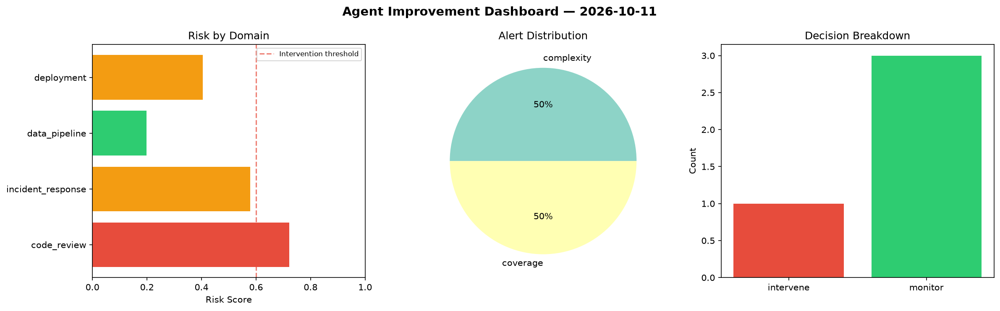
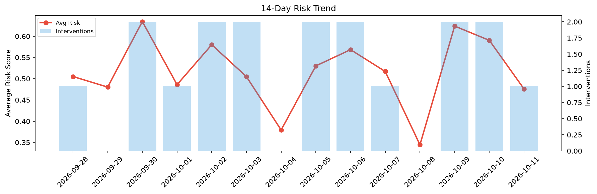

# Agent Improvement Report — 2026-10-11

**Cycle ID:** `82e1b64d` | **Avg Risk:** 0.4758 | **Interventions:** 1/4

## Risk Matrix

| Domain | Risk Score | Decision | Alerts |
|--------|-----------|----------|--------|
| code_review | 0.7218 | intervene | complexity, coverage |
| incident_response | 0.5784 | monitor | none |
| data_pipeline | 0.1987 | monitor | none |
| deployment | 0.4045 | monitor | none |

## Delta vs Yesterday

| Domain | Today | Yesterday | Change |
|--------|-------|-----------|--------|
| code_review | 0.7218 | 0.7333 | 📉 -1.6% |
| incident_response | 0.5784 | 0.7272 | 📉 -20.5% |
| data_pipeline | 0.1987 | 0.3948 | 📉 -49.7% |
| deployment | 0.4045 | 0.5059 | 📉 -20.0% |

**Refinement:** `{'adjustment': 'maintain', 'trend': 'improving', 'window': 4}`