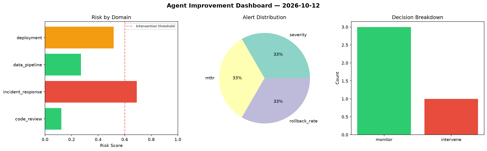
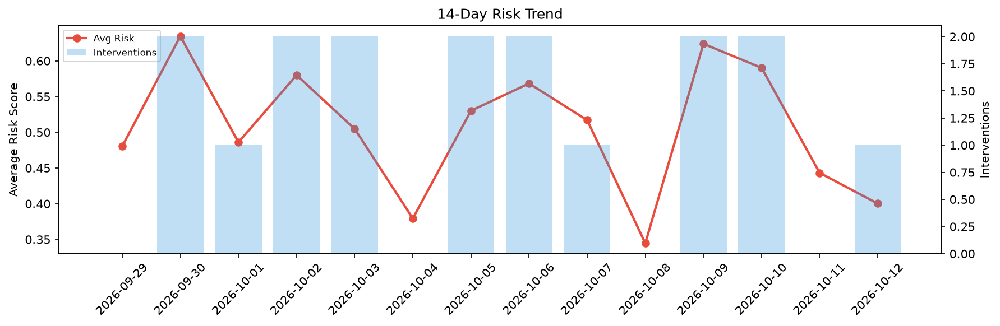

# Agent Improvement Report — 2026-10-12

**Cycle ID:** `f2179fbb` | **Avg Risk:** 0.4001 | **Interventions:** 1/4

## Risk Matrix

| Domain | Risk Score | Decision | Alerts |
|--------|-----------|----------|--------|
| code_review | 0.1225 | monitor | none |
| incident_response | 0.6903 | intervene | severity, mttr |
| data_pipeline | 0.2713 | monitor | none |
| deployment | 0.5165 | monitor | rollback_rate |

## Delta vs Yesterday

| Domain | Today | Yesterday | Change |
|--------|-------|-----------|--------|
| code_review | 0.1225 | 0.5688 | 📉 -78.5% |
| incident_response | 0.6903 | 0.2923 | 📈 136.2% |
| data_pipeline | 0.2713 | 0.5197 | 📉 -47.8% |
| deployment | 0.5165 | 0.3915 | 📈 31.9% |

**Refinement:** `{'adjustment': 'tighten_thresholds', 'trend': 'degrading', 'window': 4}`