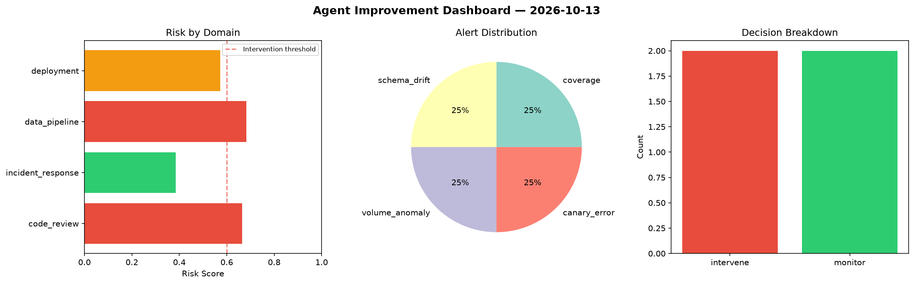
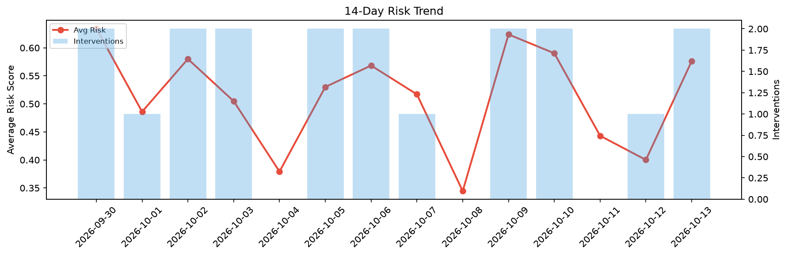

# Agent Improvement Report — 2026-10-13

**Cycle ID:** `b900f2fc` | **Avg Risk:** 0.5764 | **Interventions:** 2/4

## Risk Matrix

| Domain | Risk Score | Decision | Alerts |
|--------|-----------|----------|--------|
| code_review | 0.6654 | intervene | coverage |
| incident_response | 0.3849 | monitor | none |
| data_pipeline | 0.6828 | intervene | schema_drift, volume_anomaly |
| deployment | 0.5726 | monitor | canary_error |

## Delta vs Yesterday

| Domain | Today | Yesterday | Change |
|--------|-------|-----------|--------|
| code_review | 0.6654 | 0.1225 | 📈 443.2% |
| incident_response | 0.3849 | 0.6903 | 📉 -44.2% |
| data_pipeline | 0.6828 | 0.2713 | 📈 151.7% |
| deployment | 0.5726 | 0.5165 | 📈 10.9% |

**Refinement:** `{'adjustment': 'maintain', 'trend': 'improving', 'window': 4}`