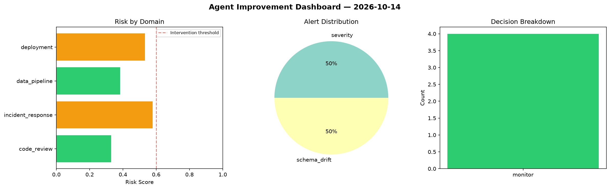
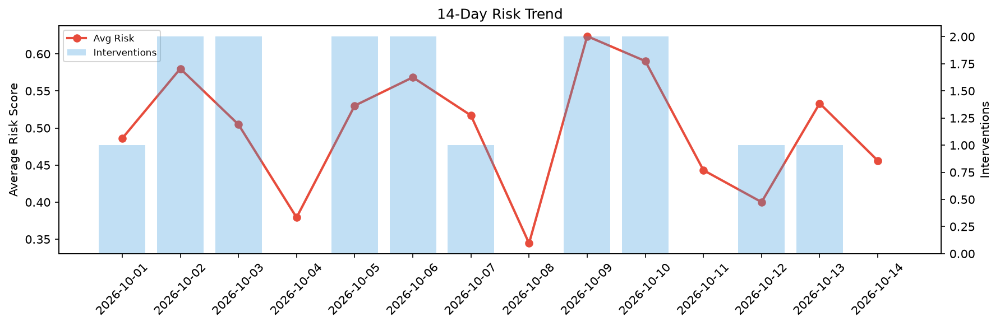

# Agent Improvement Report — 2026-10-14

**Cycle ID:** `49ab7d72` | **Avg Risk:** 0.456 | **Interventions:** 0/4

## Risk Matrix

| Domain | Risk Score | Decision | Alerts |
|--------|-----------|----------|--------|
| code_review | 0.3293 | monitor | none |
| incident_response | 0.5791 | monitor | severity |
| data_pipeline | 0.3836 | monitor | schema_drift |
| deployment | 0.5319 | monitor | none |

## Delta vs Yesterday

| Domain | Today | Yesterday | Change |
|--------|-------|-----------|--------|
| code_review | 0.3293 | 0.4041 | 📉 -18.5% |
| incident_response | 0.5791 | 0.4614 | 📈 25.5% |
| data_pipeline | 0.3836 | 0.7066 | 📉 -45.7% |
| deployment | 0.5319 | 0.5609 | 📉 -5.2% |

**Refinement:** `{'adjustment': 'tighten_thresholds', 'trend': 'degrading', 'window': 4}`