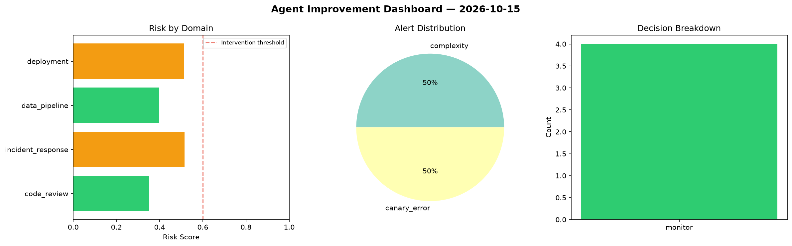
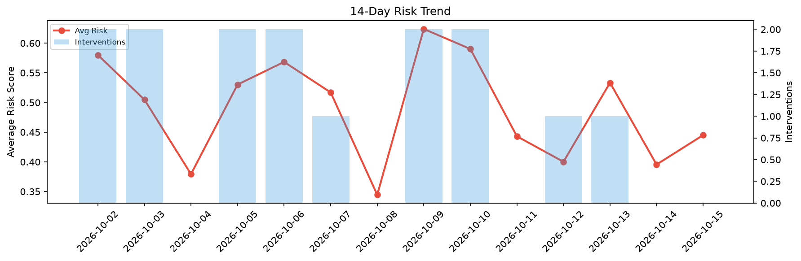

# Agent Improvement Report — 2026-10-15

**Cycle ID:** `2f267ebf` | **Avg Risk:** 0.445 | **Interventions:** 0/4

## Risk Matrix

| Domain | Risk Score | Decision | Alerts |
|--------|-----------|----------|--------|
| code_review | 0.3526 | monitor | complexity |
| incident_response | 0.5152 | monitor | none |
| data_pipeline | 0.3984 | monitor | none |
| deployment | 0.5137 | monitor | canary_error |

## Delta vs Yesterday

| Domain | Today | Yesterday | Change |
|--------|-------|-----------|--------|
| code_review | 0.3526 | 0.4414 | 📉 -20.1% |
| incident_response | 0.5152 | 0.4733 | 📈 8.9% |
| data_pipeline | 0.3984 | 0.2624 | 📈 51.8% |
| deployment | 0.5137 | 0.4049 | 📈 26.9% |

**Refinement:** `{'adjustment': 'tighten_thresholds', 'trend': 'degrading', 'window': 4}`