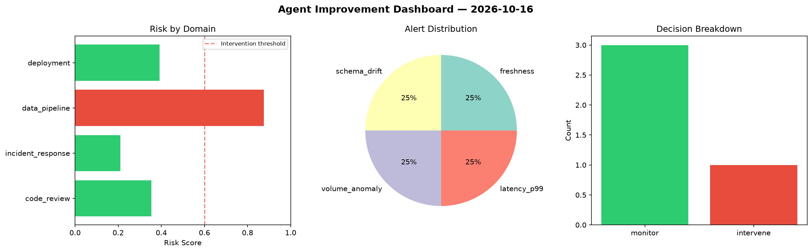
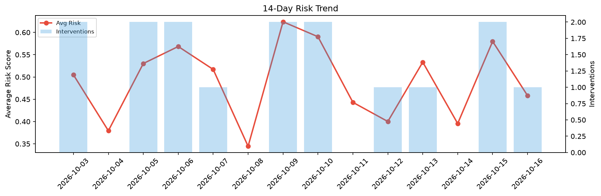

# Agent Improvement Report — 2026-10-16

**Cycle ID:** `83fc1e8d` | **Avg Risk:** 0.4582 | **Interventions:** 1/4

## Risk Matrix

| Domain | Risk Score | Decision | Alerts |
|--------|-----------|----------|--------|
| code_review | 0.3545 | monitor | none |
| incident_response | 0.2097 | monitor | none |
| data_pipeline | 0.876 | intervene | freshness, schema_drift, volume_anomaly |
| deployment | 0.3924 | monitor | latency_p99 |

## Delta vs Yesterday

| Domain | Today | Yesterday | Change |
|--------|-------|-----------|--------|
| code_review | 0.3545 | 0.8232 | 📉 -56.9% |
| incident_response | 0.2097 | 0.2885 | 📉 -27.3% |
| data_pipeline | 0.876 | 0.4861 | 📈 80.2% |
| deployment | 0.3924 | 0.7213 | 📉 -45.6% |

**Refinement:** `{'adjustment': 'tighten_thresholds', 'trend': 'degrading', 'window': 4}`