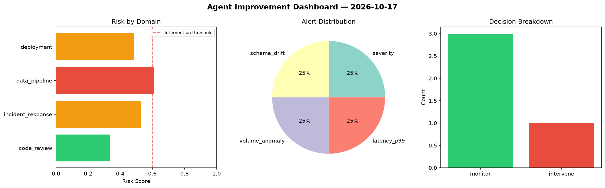
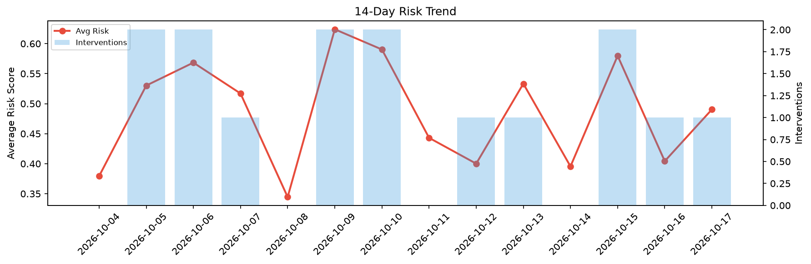

# Agent Improvement Report — 2026-10-17

**Cycle ID:** `65e10885` | **Avg Risk:** 0.4904 | **Interventions:** 1/4

## Risk Matrix

| Domain | Risk Score | Decision | Alerts |
|--------|-----------|----------|--------|
| code_review | 0.3352 | monitor | none |
| incident_response | 0.5277 | monitor | severity |
| data_pipeline | 0.6106 | intervene | schema_drift, volume_anomaly |
| deployment | 0.4881 | monitor | latency_p99 |

## Delta vs Yesterday

| Domain | Today | Yesterday | Change |
|--------|-------|-----------|--------|
| code_review | 0.3352 | 0.2932 | 📈 14.3% |
| incident_response | 0.5277 | 0.2987 | 📈 76.7% |
| data_pipeline | 0.6106 | 0.3805 | 📈 60.5% |
| deployment | 0.4881 | 0.6449 | 📉 -24.3% |

**Refinement:** `{'adjustment': 'tighten_thresholds', 'trend': 'degrading', 'window': 4}`