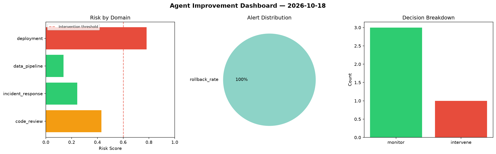
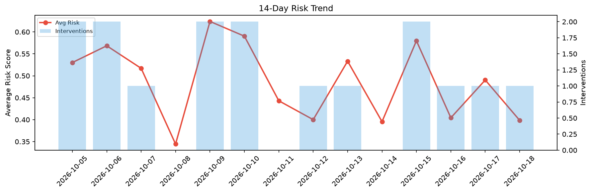

# Agent Improvement Report — 2026-10-18

**Cycle ID:** `87c7114b` | **Avg Risk:** 0.3985 | **Interventions:** 1/4

## Risk Matrix

| Domain | Risk Score | Decision | Alerts |
|--------|-----------|----------|--------|
| code_review | 0.4316 | monitor | none |
| incident_response | 0.2445 | monitor | none |
| data_pipeline | 0.1366 | monitor | none |
| deployment | 0.7813 | intervene | rollback_rate |

## Delta vs Yesterday

| Domain | Today | Yesterday | Change |
|--------|-------|-----------|--------|
| code_review | 0.4316 | 0.3352 | 📈 28.8% |
| incident_response | 0.2445 | 0.5277 | 📉 -53.7% |
| data_pipeline | 0.1366 | 0.6106 | 📉 -77.6% |
| deployment | 0.7813 | 0.4881 | 📈 60.1% |

**Refinement:** `{'adjustment': 'tighten_thresholds', 'trend': 'degrading', 'window': 4}`