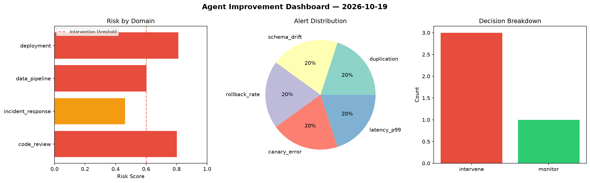
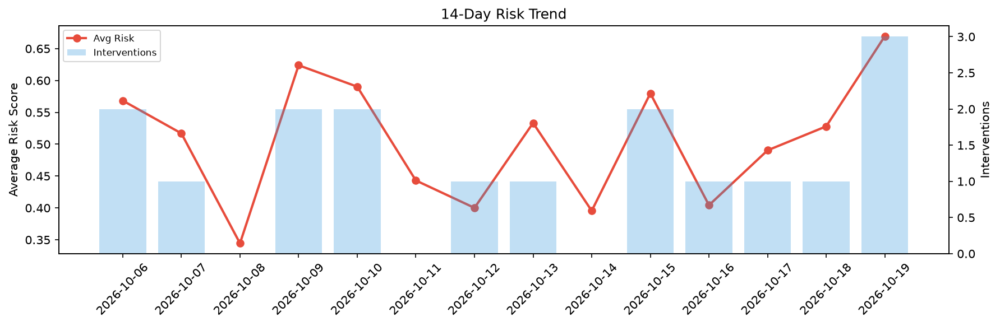

# Agent Improvement Report — 2026-10-19

**Cycle ID:** `dc364e4d` | **Avg Risk:** 0.6695 | **Interventions:** 3/4

## Risk Matrix

| Domain | Risk Score | Decision | Alerts |
|--------|-----------|----------|--------|
| code_review | 0.802 | intervene | duplication |
| incident_response | 0.4623 | monitor | none |
| data_pipeline | 0.602 | intervene | schema_drift |
| deployment | 0.8119 | intervene | rollback_rate, canary_error, latency_p99 |

## Delta vs Yesterday

| Domain | Today | Yesterday | Change |
|--------|-------|-----------|--------|
| code_review | 0.802 | 0.4553 | 📈 76.1% |
| incident_response | 0.4623 | 0.6343 | 📉 -27.1% |
| data_pipeline | 0.602 | 0.4349 | 📈 38.4% |
| deployment | 0.8119 | 0.5873 | 📈 38.2% |

**Refinement:** `{'adjustment': 'tighten_thresholds', 'trend': 'degrading', 'window': 4}`