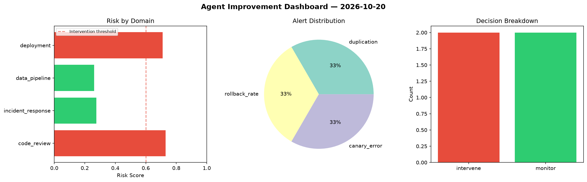
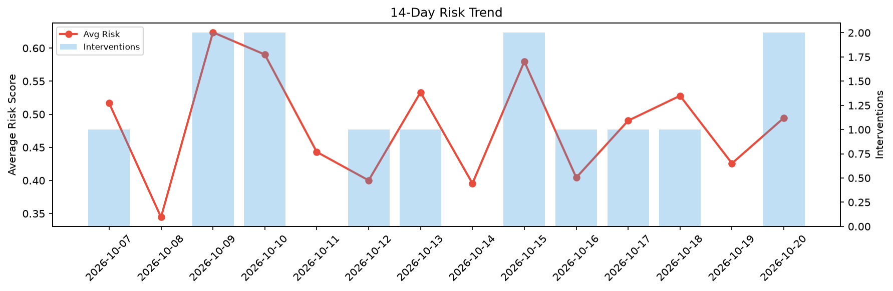

# Agent Improvement Report — 2026-10-20

**Cycle ID:** `5e9690e3` | **Avg Risk:** 0.4946 | **Interventions:** 2/4

## Risk Matrix

| Domain | Risk Score | Decision | Alerts |
|--------|-----------|----------|--------|
| code_review | 0.7299 | intervene | duplication |
| incident_response | 0.2763 | monitor | none |
| data_pipeline | 0.2622 | monitor | none |
| deployment | 0.7099 | intervene | rollback_rate, canary_error |

## Delta vs Yesterday

| Domain | Today | Yesterday | Change |
|--------|-------|-----------|--------|
| code_review | 0.7299 | 0.1527 | 📈 378.0% |
| incident_response | 0.2763 | 0.4779 | 📉 -42.2% |
| data_pipeline | 0.2622 | 0.584 | 📉 -55.1% |
| deployment | 0.7099 | 0.4885 | 📈 45.3% |

**Refinement:** `{'adjustment': 'maintain', 'trend': 'improving', 'window': 4}`