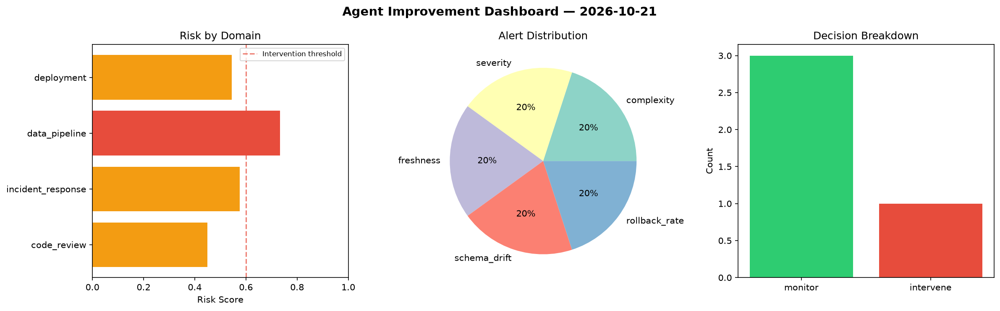
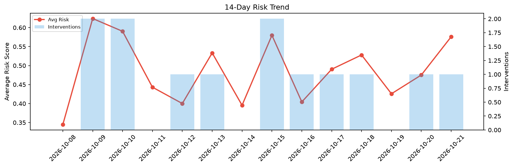

# Agent Improvement Report — 2026-10-21

**Cycle ID:** `57a928d5` | **Avg Risk:** 0.576 | **Interventions:** 1/4

## Risk Matrix

| Domain | Risk Score | Decision | Alerts |
|--------|-----------|----------|--------|
| code_review | 0.4495 | monitor | complexity |
| incident_response | 0.5758 | monitor | severity |
| data_pipeline | 0.7339 | intervene | freshness, schema_drift |
| deployment | 0.5448 | monitor | rollback_rate |

## Delta vs Yesterday

| Domain | Today | Yesterday | Change |
|--------|-------|-----------|--------|
| code_review | 0.4495 | 0.5076 | 📉 -11.4% |
| incident_response | 0.5758 | 0.313 | 📈 84.0% |
| data_pipeline | 0.7339 | 0.6036 | 📈 21.6% |
| deployment | 0.5448 | 0.4766 | 📈 14.3% |

**Refinement:** `{'adjustment': 'tighten_thresholds', 'trend': 'degrading', 'window': 4}`