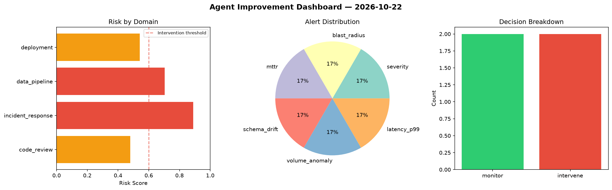
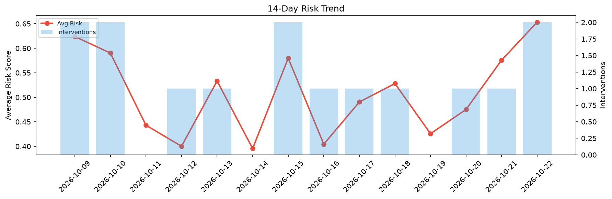

# Agent Improvement Report — 2026-10-22

**Cycle ID:** `4e471dc2` | **Avg Risk:** 0.6534 | **Interventions:** 2/4

## Risk Matrix

| Domain | Risk Score | Decision | Alerts |
|--------|-----------|----------|--------|
| code_review | 0.4791 | monitor | none |
| incident_response | 0.8892 | intervene | severity, blast_radius, mttr |
| data_pipeline | 0.7043 | intervene | schema_drift, volume_anomaly |
| deployment | 0.5411 | monitor | latency_p99 |

## Delta vs Yesterday

| Domain | Today | Yesterday | Change |
|--------|-------|-----------|--------|
| code_review | 0.4791 | 0.4495 | 📈 6.6% |
| incident_response | 0.8892 | 0.5758 | 📈 54.4% |
| data_pipeline | 0.7043 | 0.7339 | 📉 -4.0% |
| deployment | 0.5411 | 0.5448 | 📉 -0.7% |

**Refinement:** `{'adjustment': 'tighten_thresholds', 'trend': 'degrading', 'window': 4}`