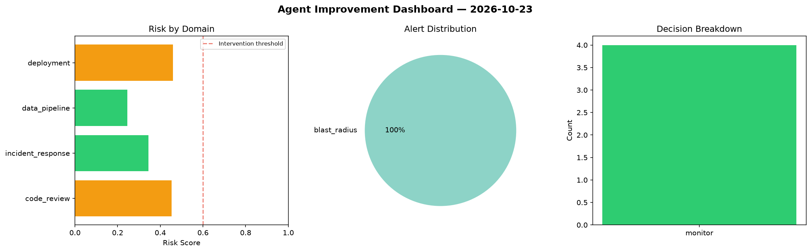
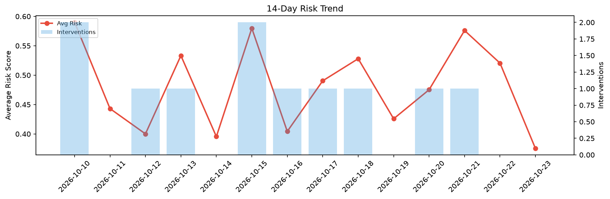

# Agent Improvement Report — 2026-10-23

**Cycle ID:** `3c8c8497` | **Avg Risk:** 0.3752 | **Interventions:** 0/4

## Risk Matrix

| Domain | Risk Score | Decision | Alerts |
|--------|-----------|----------|--------|
| code_review | 0.4522 | monitor | none |
| incident_response | 0.344 | monitor | blast_radius |
| data_pipeline | 0.2453 | monitor | none |
| deployment | 0.4592 | monitor | none |

## Delta vs Yesterday

| Domain | Today | Yesterday | Change |
|--------|-------|-----------|--------|
| code_review | 0.4522 | 0.527 | 📉 -14.2% |
| incident_response | 0.344 | 0.5378 | 📉 -36.0% |
| data_pipeline | 0.2453 | 0.493 | 📉 -50.2% |
| deployment | 0.4592 | 0.5244 | 📉 -12.4% |

**Refinement:** `{'adjustment': 'tighten_thresholds', 'trend': 'degrading', 'window': 4}`