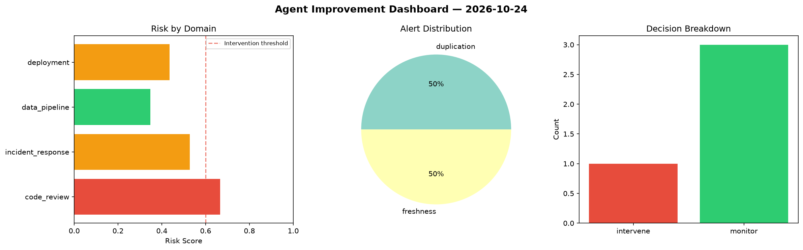
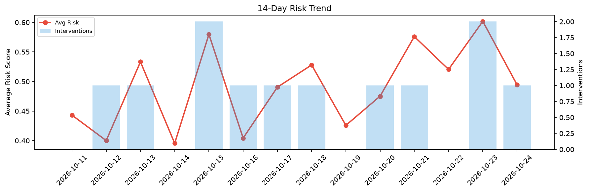

# Agent Improvement Report — 2026-10-24

**Cycle ID:** `2bf3c516` | **Avg Risk:** 0.4946 | **Interventions:** 1/4

## Risk Matrix

| Domain | Risk Score | Decision | Alerts |
|--------|-----------|----------|--------|
| code_review | 0.6663 | intervene | duplication |
| incident_response | 0.5285 | monitor | none |
| data_pipeline | 0.3473 | monitor | freshness |
| deployment | 0.4362 | monitor | none |

## Delta vs Yesterday

| Domain | Today | Yesterday | Change |
|--------|-------|-----------|--------|
| code_review | 0.6663 | 0.4635 | 📈 43.8% |
| incident_response | 0.5285 | 0.4673 | 📈 13.1% |
| data_pipeline | 0.3473 | 0.7626 | 📉 -54.5% |
| deployment | 0.4362 | 0.7139 | 📉 -38.9% |

**Refinement:** `{'adjustment': 'maintain', 'trend': 'improving', 'window': 4}`