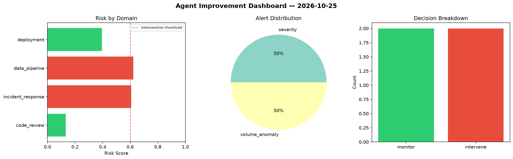
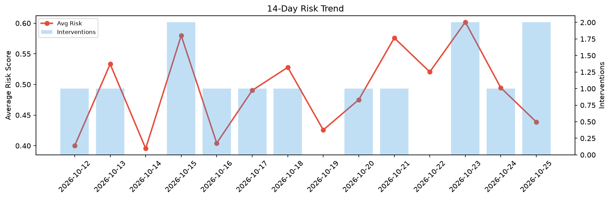

# Agent Improvement Report — 2026-10-25

**Cycle ID:** `d7c5c180` | **Avg Risk:** 0.4388 | **Interventions:** 2/4

## Risk Matrix

| Domain | Risk Score | Decision | Alerts |
|--------|-----------|----------|--------|
| code_review | 0.133 | monitor | none |
| incident_response | 0.6063 | intervene | severity |
| data_pipeline | 0.6219 | intervene | volume_anomaly |
| deployment | 0.3942 | monitor | none |

## Delta vs Yesterday

| Domain | Today | Yesterday | Change |
|--------|-------|-----------|--------|
| code_review | 0.133 | 0.6663 | 📉 -80.0% |
| incident_response | 0.6063 | 0.5285 | 📈 14.7% |
| data_pipeline | 0.6219 | 0.3473 | 📈 79.1% |
| deployment | 0.3942 | 0.4362 | 📉 -9.6% |

**Refinement:** `{'adjustment': 'tighten_thresholds', 'trend': 'degrading', 'window': 4}`