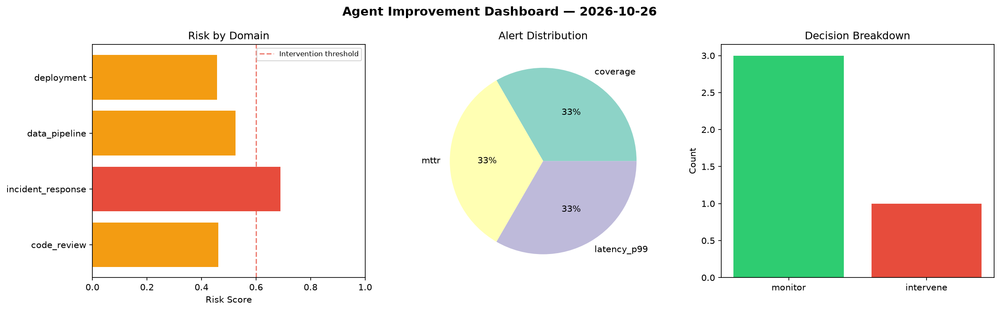
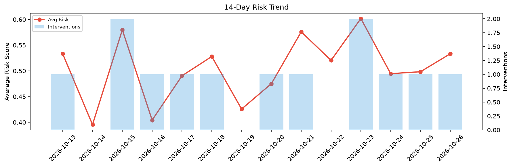

# Agent Improvement Report — 2026-10-26

**Cycle ID:** `9eb21eb4` | **Avg Risk:** 0.5333 | **Interventions:** 1/4

## Risk Matrix

| Domain | Risk Score | Decision | Alerts |
|--------|-----------|----------|--------|
| code_review | 0.4622 | monitor | coverage |
| incident_response | 0.6893 | intervene | mttr |
| data_pipeline | 0.5245 | monitor | none |
| deployment | 0.4574 | monitor | latency_p99 |

## Delta vs Yesterday

| Domain | Today | Yesterday | Change |
|--------|-------|-----------|--------|
| code_review | 0.4622 | 0.1567 | 📈 195.0% |
| incident_response | 0.6893 | 0.5243 | 📈 31.5% |
| data_pipeline | 0.5245 | 0.7507 | 📉 -30.1% |
| deployment | 0.4574 | 0.5617 | 📉 -18.6% |

**Refinement:** `{'adjustment': 'maintain', 'trend': 'improving', 'window': 4}`