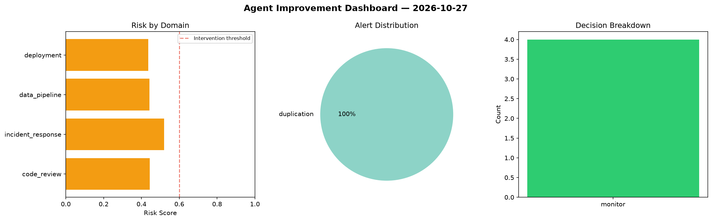
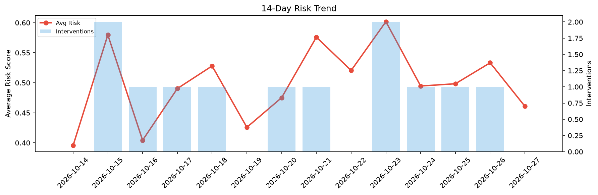

# Agent Improvement Report — 2026-10-27

**Cycle ID:** `02a11d94` | **Avg Risk:** 0.4608 | **Interventions:** 0/4

## Risk Matrix

| Domain | Risk Score | Decision | Alerts |
|--------|-----------|----------|--------|
| code_review | 0.4446 | monitor | duplication |
| incident_response | 0.5193 | monitor | none |
| data_pipeline | 0.4428 | monitor | none |
| deployment | 0.4365 | monitor | none |

## Delta vs Yesterday

| Domain | Today | Yesterday | Change |
|--------|-------|-----------|--------|
| code_review | 0.4446 | 0.4622 | 📉 -3.8% |
| incident_response | 0.5193 | 0.6893 | 📉 -24.7% |
| data_pipeline | 0.4428 | 0.5245 | 📉 -15.6% |
| deployment | 0.4365 | 0.4574 | 📉 -4.6% |

**Refinement:** `{'adjustment': 'maintain', 'trend': 'improving', 'window': 4}`