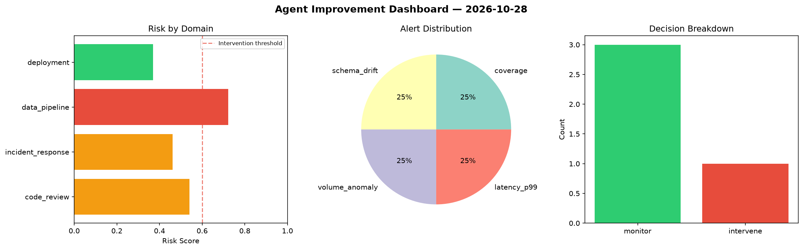
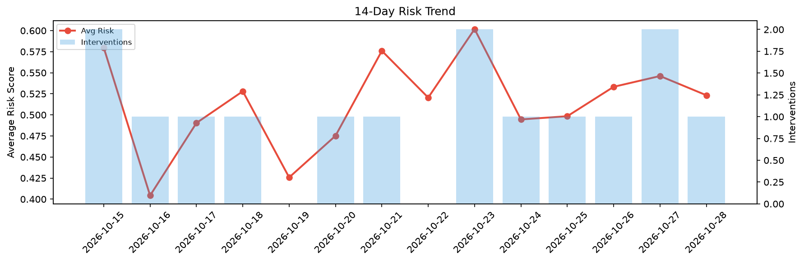

# Agent Improvement Report — 2026-10-28

**Cycle ID:** `fa117423` | **Avg Risk:** 0.5233 | **Interventions:** 1/4

## Risk Matrix

| Domain | Risk Score | Decision | Alerts |
|--------|-----------|----------|--------|
| code_review | 0.5404 | monitor | coverage |
| incident_response | 0.461 | monitor | none |
| data_pipeline | 0.7218 | intervene | schema_drift, volume_anomaly |
| deployment | 0.37 | monitor | latency_p99 |

## Delta vs Yesterday

| Domain | Today | Yesterday | Change |
|--------|-------|-----------|--------|
| code_review | 0.5404 | 0.6835 | 📉 -20.9% |
| incident_response | 0.461 | 0.6584 | 📉 -30.0% |
| data_pipeline | 0.7218 | 0.2532 | 📈 185.1% |
| deployment | 0.37 | 0.5892 | 📉 -37.2% |

**Refinement:** `{'adjustment': 'maintain', 'trend': 'improving', 'window': 4}`