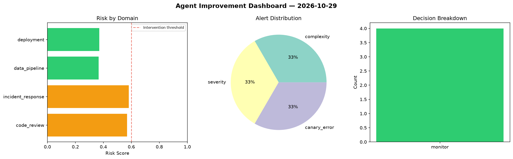
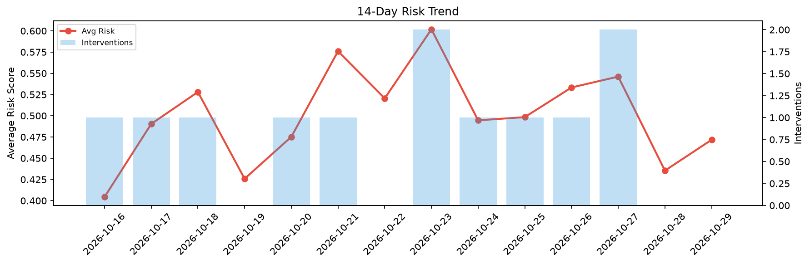

# Agent Improvement Report — 2026-10-29

**Cycle ID:** `45ef0a5e` | **Avg Risk:** 0.4717 | **Interventions:** 0/4

## Risk Matrix

| Domain | Risk Score | Decision | Alerts |
|--------|-----------|----------|--------|
| code_review | 0.5694 | monitor | complexity |
| incident_response | 0.5811 | monitor | severity |
| data_pipeline | 0.3658 | monitor | none |
| deployment | 0.3705 | monitor | canary_error |

## Delta vs Yesterday

| Domain | Today | Yesterday | Change |
|--------|-------|-----------|--------|
| code_review | 0.5694 | 0.2423 | 📈 135.0% |
| incident_response | 0.5811 | 0.565 | 📈 2.8% |
| data_pipeline | 0.3658 | 0.4826 | 📉 -24.2% |
| deployment | 0.3705 | 0.4519 | 📉 -18.0% |

**Refinement:** `{'adjustment': 'maintain', 'trend': 'improving', 'window': 4}`