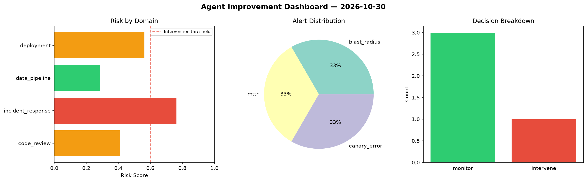
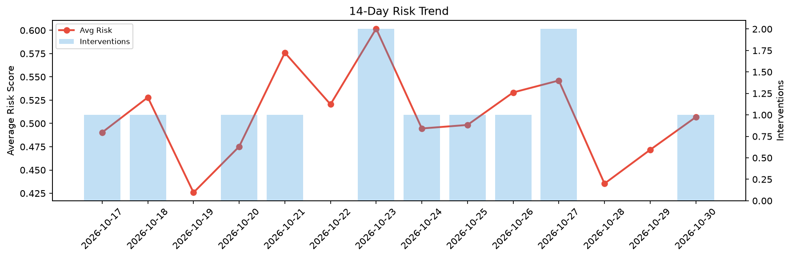

# Agent Improvement Report — 2026-10-30

**Cycle ID:** `f4948cd9` | **Avg Risk:** 0.5068 | **Interventions:** 1/4

## Risk Matrix

| Domain | Risk Score | Decision | Alerts |
|--------|-----------|----------|--------|
| code_review | 0.4117 | monitor | none |
| incident_response | 0.7638 | intervene | blast_radius, mttr |
| data_pipeline | 0.2879 | monitor | none |
| deployment | 0.5638 | monitor | canary_error |

## Delta vs Yesterday

| Domain | Today | Yesterday | Change |
|--------|-------|-----------|--------|
| code_review | 0.4117 | 0.5694 | 📉 -27.7% |
| incident_response | 0.7638 | 0.5811 | 📈 31.4% |
| data_pipeline | 0.2879 | 0.3658 | 📉 -21.3% |
| deployment | 0.5638 | 0.3705 | 📈 52.2% |

**Refinement:** `{'adjustment': 'tighten_thresholds', 'trend': 'degrading', 'window': 4}`