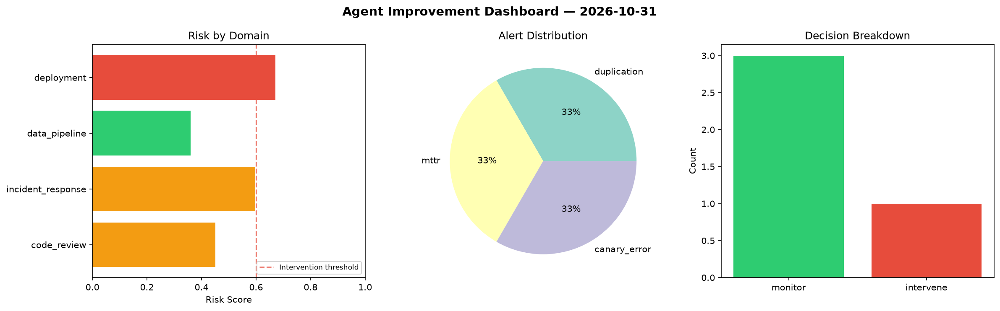
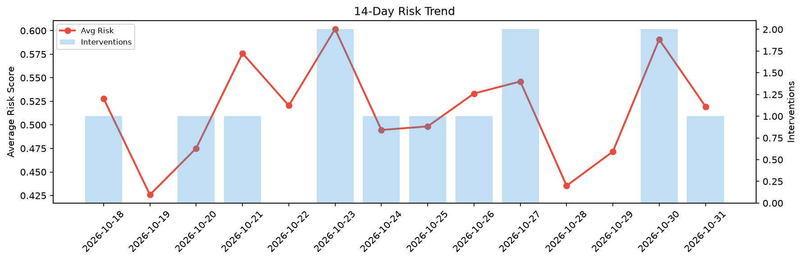

# Agent Improvement Report — 2026-10-31

**Cycle ID:** `627beb4b` | **Avg Risk:** 0.5195 | **Interventions:** 1/4

## Risk Matrix

| Domain | Risk Score | Decision | Alerts |
|--------|-----------|----------|--------|
| code_review | 0.4501 | monitor | duplication |
| incident_response | 0.5972 | monitor | mttr |
| data_pipeline | 0.3596 | monitor | none |
| deployment | 0.6712 | intervene | canary_error |

## Delta vs Yesterday

| Domain | Today | Yesterday | Change |
|--------|-------|-----------|--------|
| code_review | 0.4501 | 0.7954 | 📉 -43.4% |
| incident_response | 0.5972 | 0.4144 | 📈 44.1% |
| data_pipeline | 0.3596 | 0.5156 | 📉 -30.3% |
| deployment | 0.6712 | 0.6376 | 📈 5.3% |

**Refinement:** `{'adjustment': 'tighten_thresholds', 'trend': 'degrading', 'window': 4}`