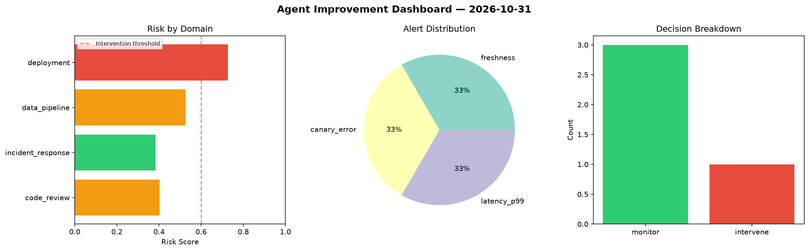
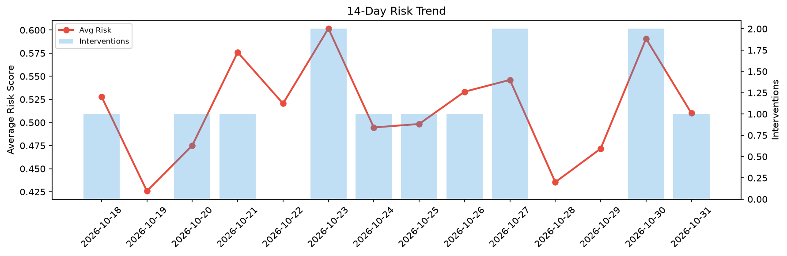

# Agent Improvement Report — 2026-10-31

**Cycle ID:** `1bb3ec44` | **Avg Risk:** 0.51 | **Interventions:** 1/4

## Risk Matrix

| Domain | Risk Score | Decision | Alerts |
|--------|-----------|----------|--------|
| code_review | 0.4034 | monitor | none |
| incident_response | 0.3838 | monitor | none |
| data_pipeline | 0.5256 | monitor | freshness |
| deployment | 0.7272 | intervene | canary_error, latency_p99 |

## Delta vs Yesterday

| Domain | Today | Yesterday | Change |
|--------|-------|-----------|--------|
| code_review | 0.4034 | 0.7954 | 📉 -49.3% |
| incident_response | 0.3838 | 0.4144 | 📉 -7.4% |
| data_pipeline | 0.5256 | 0.5156 | 📈 1.9% |
| deployment | 0.7272 | 0.6376 | 📈 14.1% |

**Refinement:** `{'adjustment': 'tighten_thresholds', 'trend': 'degrading', 'window': 4}`