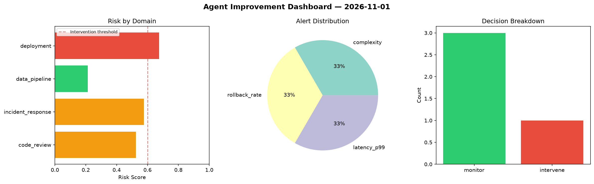
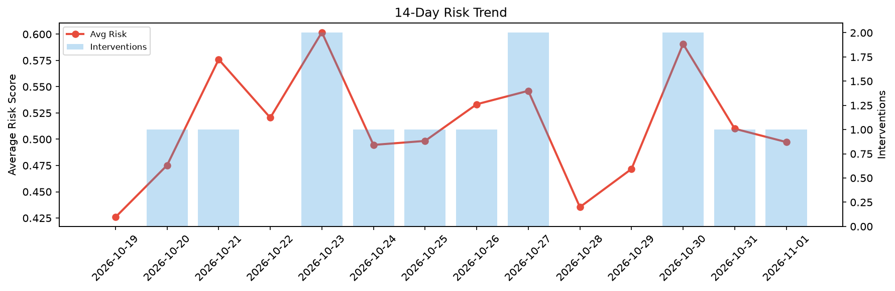

# Agent Improvement Report — 2026-11-01

**Cycle ID:** `4b735515` | **Avg Risk:** 0.4973 | **Interventions:** 1/4

## Risk Matrix

| Domain | Risk Score | Decision | Alerts |
|--------|-----------|----------|--------|
| code_review | 0.5247 | monitor | complexity |
| incident_response | 0.5761 | monitor | none |
| data_pipeline | 0.2126 | monitor | none |
| deployment | 0.6758 | intervene | rollback_rate, latency_p99 |

## Delta vs Yesterday

| Domain | Today | Yesterday | Change |
|--------|-------|-----------|--------|
| code_review | 0.5247 | 0.4034 | 📈 30.1% |
| incident_response | 0.5761 | 0.3838 | 📈 50.1% |
| data_pipeline | 0.2126 | 0.5256 | 📉 -59.6% |
| deployment | 0.6758 | 0.7272 | 📉 -7.1% |

**Refinement:** `{'adjustment': 'tighten_thresholds', 'trend': 'degrading', 'window': 4}`