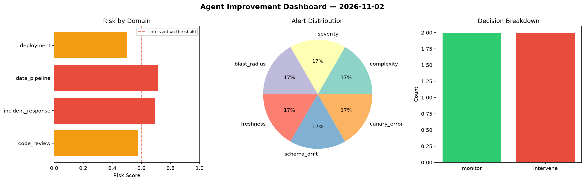
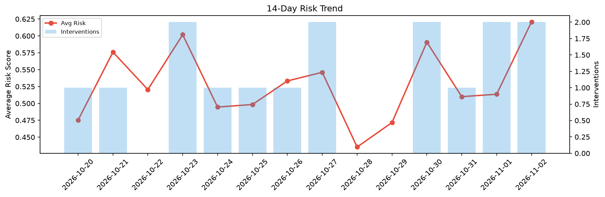

# Agent Improvement Report — 2026-11-02

**Cycle ID:** `65afcdfa` | **Avg Risk:** 0.6208 | **Interventions:** 2/4

## Risk Matrix

| Domain | Risk Score | Decision | Alerts |
|--------|-----------|----------|--------|
| code_review | 0.5764 | monitor | complexity |
| incident_response | 0.6914 | intervene | severity, blast_radius |
| data_pipeline | 0.7144 | intervene | freshness, schema_drift |
| deployment | 0.501 | monitor | canary_error |

## Delta vs Yesterday

| Domain | Today | Yesterday | Change |
|--------|-------|-----------|--------|
| code_review | 0.5764 | 0.197 | 📈 192.6% |
| incident_response | 0.6914 | 0.5268 | 📈 31.2% |
| data_pipeline | 0.7144 | 0.6058 | 📈 17.9% |
| deployment | 0.501 | 0.7248 | 📉 -30.9% |

**Refinement:** `{'adjustment': 'maintain', 'trend': 'improving', 'window': 4}`