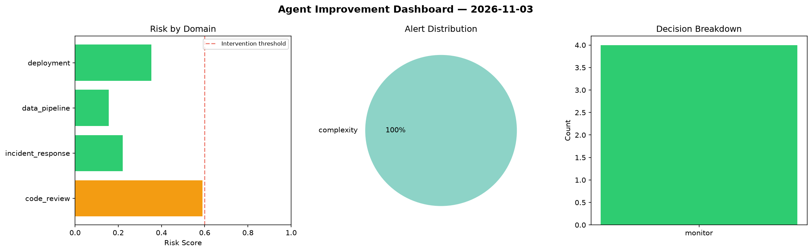
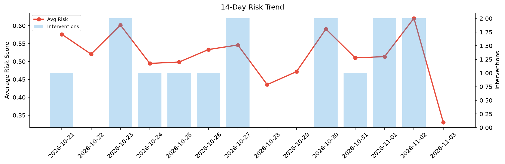

# Agent Improvement Report — 2026-11-03

**Cycle ID:** `2845d0e5` | **Avg Risk:** 0.3299 | **Interventions:** 0/4

## Risk Matrix

| Domain | Risk Score | Decision | Alerts |
|--------|-----------|----------|--------|
| code_review | 0.5897 | monitor | complexity |
| incident_response | 0.2204 | monitor | none |
| data_pipeline | 0.156 | monitor | none |
| deployment | 0.3533 | monitor | none |

## Delta vs Yesterday

| Domain | Today | Yesterday | Change |
|--------|-------|-----------|--------|
| code_review | 0.5897 | 0.5764 | 📈 2.3% |
| incident_response | 0.2204 | 0.6914 | 📉 -68.1% |
| data_pipeline | 0.156 | 0.7144 | 📉 -78.2% |
| deployment | 0.3533 | 0.501 | 📉 -29.5% |

**Refinement:** `{'adjustment': 'maintain', 'trend': 'improving', 'window': 4}`