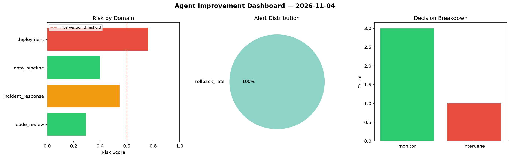
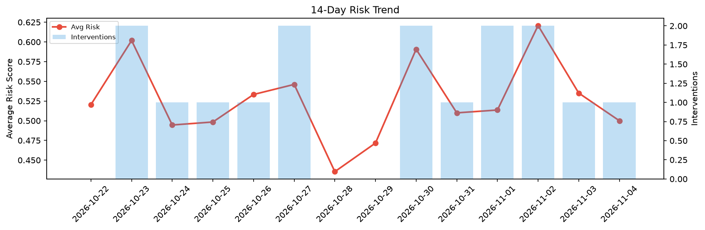

# Agent Improvement Report — 2026-11-04

**Cycle ID:** `2d770952` | **Avg Risk:** 0.5 | **Interventions:** 1/4

## Risk Matrix

| Domain | Risk Score | Decision | Alerts |
|--------|-----------|----------|--------|
| code_review | 0.2914 | monitor | none |
| incident_response | 0.5471 | monitor | none |
| data_pipeline | 0.3994 | monitor | none |
| deployment | 0.7623 | intervene | rollback_rate |

## Delta vs Yesterday

| Domain | Today | Yesterday | Change |
|--------|-------|-----------|--------|
| code_review | 0.2914 | 0.6879 | 📉 -57.6% |
| incident_response | 0.5471 | 0.337 | 📈 62.3% |
| data_pipeline | 0.3994 | 0.5182 | 📉 -22.9% |
| deployment | 0.7623 | 0.5971 | 📈 27.7% |

**Refinement:** `{'adjustment': 'tighten_thresholds', 'trend': 'degrading', 'window': 4}`