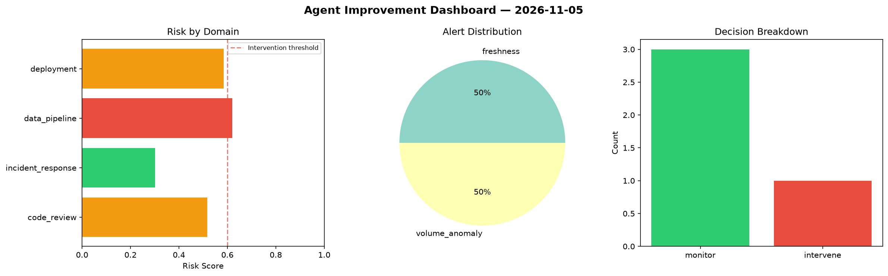
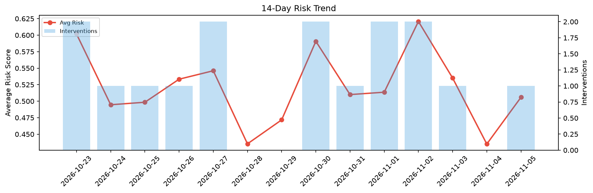

# Agent Improvement Report — 2026-11-05

**Cycle ID:** `860e270b` | **Avg Risk:** 0.5059 | **Interventions:** 1/4

## Risk Matrix

| Domain | Risk Score | Decision | Alerts |
|--------|-----------|----------|--------|
| code_review | 0.5173 | monitor | none |
| incident_response | 0.3013 | monitor | none |
| data_pipeline | 0.62 | intervene | freshness, volume_anomaly |
| deployment | 0.585 | monitor | none |

## Delta vs Yesterday

| Domain | Today | Yesterday | Change |
|--------|-------|-----------|--------|
| code_review | 0.5173 | 0.3962 | 📈 30.6% |
| incident_response | 0.3013 | 0.5492 | 📉 -45.1% |
| data_pipeline | 0.62 | 0.4948 | 📈 25.3% |
| deployment | 0.585 | 0.3001 | 📈 94.9% |

**Refinement:** `{'adjustment': 'tighten_thresholds', 'trend': 'degrading', 'window': 4}`