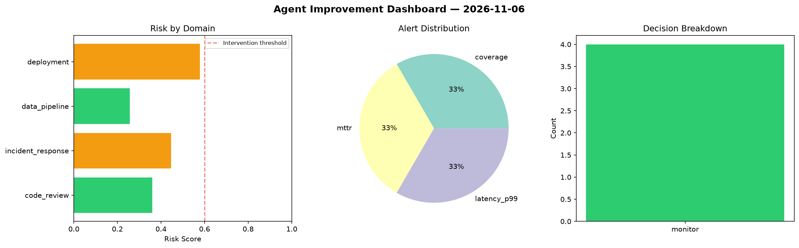
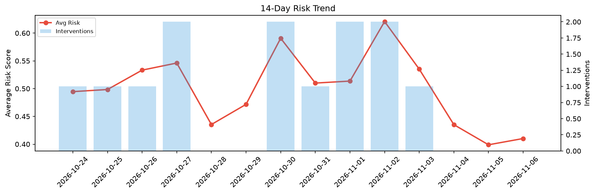

# Agent Improvement Report — 2026-11-06

**Cycle ID:** `533aad4e` | **Avg Risk:** 0.4102 | **Interventions:** 0/4

## Risk Matrix

| Domain | Risk Score | Decision | Alerts |
|--------|-----------|----------|--------|
| code_review | 0.3601 | monitor | coverage |
| incident_response | 0.446 | monitor | mttr |
| data_pipeline | 0.2568 | monitor | none |
| deployment | 0.578 | monitor | latency_p99 |

## Delta vs Yesterday

| Domain | Today | Yesterday | Change |
|--------|-------|-----------|--------|
| code_review | 0.3601 | 0.3634 | 📉 -0.9% |
| incident_response | 0.446 | 0.3956 | 📈 12.7% |
| data_pipeline | 0.2568 | 0.3264 | 📉 -21.3% |
| deployment | 0.578 | 0.5102 | 📈 13.3% |

**Refinement:** `{'adjustment': 'tighten_thresholds', 'trend': 'degrading', 'window': 4}`