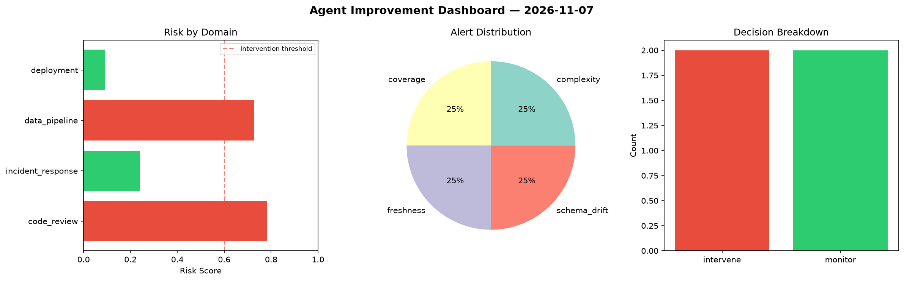
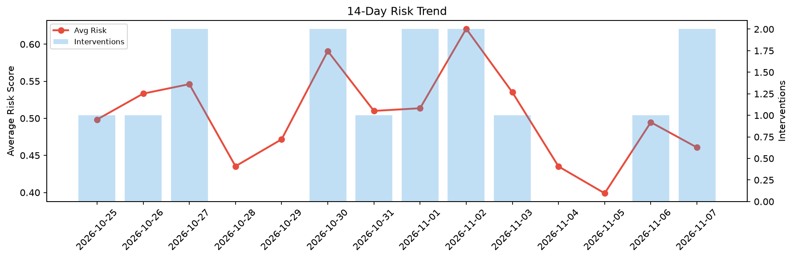

# Agent Improvement Report — 2026-11-07

**Cycle ID:** `1343eebe` | **Avg Risk:** 0.4607 | **Interventions:** 2/4

## Risk Matrix

| Domain | Risk Score | Decision | Alerts |
|--------|-----------|----------|--------|
| code_review | 0.7814 | intervene | complexity, coverage |
| incident_response | 0.2407 | monitor | none |
| data_pipeline | 0.7278 | intervene | freshness, schema_drift |
| deployment | 0.0928 | monitor | none |

## Delta vs Yesterday

| Domain | Today | Yesterday | Change |
|--------|-------|-----------|--------|
| code_review | 0.7814 | 0.5743 | 📈 36.1% |
| incident_response | 0.2407 | 0.3866 | 📉 -37.7% |
| data_pipeline | 0.7278 | 0.3181 | 📈 128.8% |
| deployment | 0.0928 | 0.6997 | 📉 -86.7% |

**Refinement:** `{'adjustment': 'maintain', 'trend': 'improving', 'window': 4}`