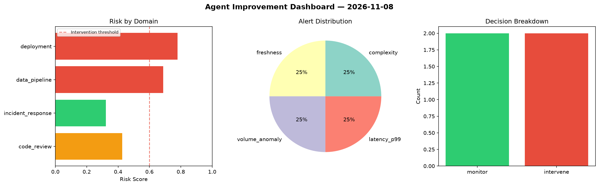
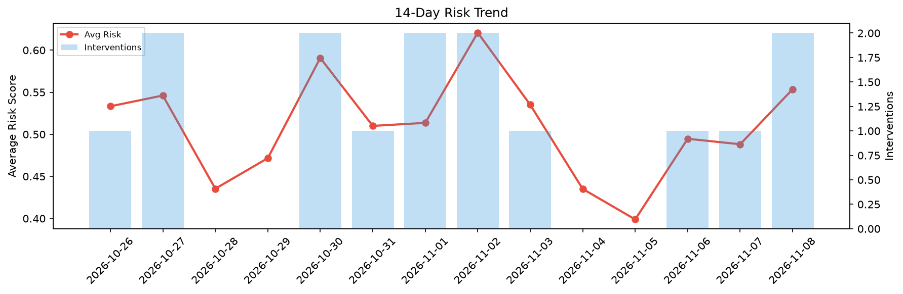

# Agent Improvement Report — 2026-11-08

**Cycle ID:** `23fa0181` | **Avg Risk:** 0.5536 | **Interventions:** 2/4

## Risk Matrix

| Domain | Risk Score | Decision | Alerts |
|--------|-----------|----------|--------|
| code_review | 0.4257 | monitor | complexity |
| incident_response | 0.322 | monitor | none |
| data_pipeline | 0.6876 | intervene | freshness, volume_anomaly |
| deployment | 0.7792 | intervene | latency_p99 |

## Delta vs Yesterday

| Domain | Today | Yesterday | Change |
|--------|-------|-----------|--------|
| code_review | 0.4257 | 0.6723 | 📉 -36.7% |
| incident_response | 0.322 | 0.4254 | 📉 -24.3% |
| data_pipeline | 0.6876 | 0.5038 | 📈 36.5% |
| deployment | 0.7792 | 0.3514 | 📈 121.7% |

**Refinement:** `{'adjustment': 'tighten_thresholds', 'trend': 'degrading', 'window': 4}`