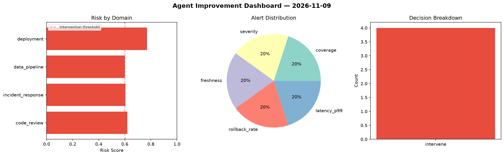
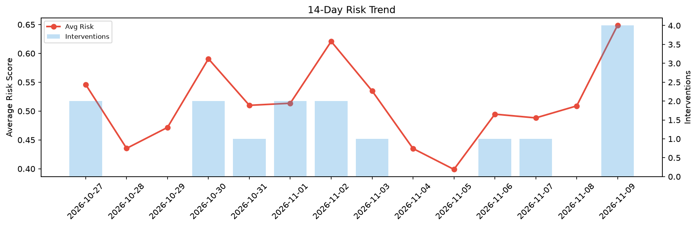

# Agent Improvement Report — 2026-11-09

**Cycle ID:** `4c18d7da` | **Avg Risk:** 0.6489 | **Interventions:** 4/4

## Risk Matrix

| Domain | Risk Score | Decision | Alerts |
|--------|-----------|----------|--------|
| code_review | 0.6198 | intervene | coverage |
| incident_response | 0.6046 | intervene | severity |
| data_pipeline | 0.6009 | intervene | freshness |
| deployment | 0.7701 | intervene | rollback_rate, latency_p99 |

## Delta vs Yesterday

| Domain | Today | Yesterday | Change |
|--------|-------|-----------|--------|
| code_review | 0.6198 | 0.5575 | 📈 11.2% |
| incident_response | 0.6046 | 0.4701 | 📈 28.6% |
| data_pipeline | 0.6009 | 0.5818 | 📈 3.3% |
| deployment | 0.7701 | 0.4264 | 📈 80.6% |

**Refinement:** `{'adjustment': 'tighten_thresholds', 'trend': 'degrading', 'window': 4}`