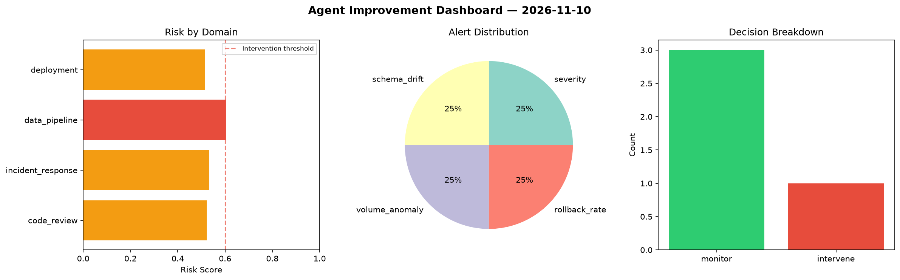
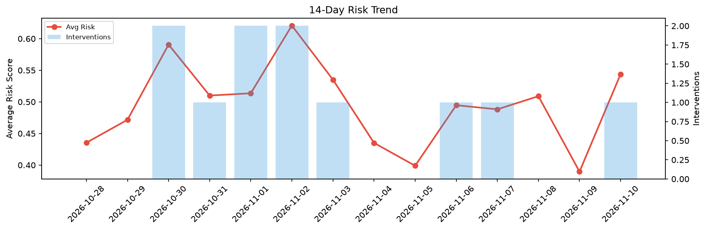

# Agent Improvement Report — 2026-11-10

**Cycle ID:** `a23f5a8d` | **Avg Risk:** 0.5439 | **Interventions:** 1/4

## Risk Matrix

| Domain | Risk Score | Decision | Alerts |
|--------|-----------|----------|--------|
| code_review | 0.522 | monitor | none |
| incident_response | 0.5341 | monitor | severity |
| data_pipeline | 0.6035 | intervene | schema_drift, volume_anomaly |
| deployment | 0.516 | monitor | rollback_rate |

## Delta vs Yesterday

| Domain | Today | Yesterday | Change |
|--------|-------|-----------|--------|
| code_review | 0.522 | 0.2871 | 📈 81.8% |
| incident_response | 0.5341 | 0.4451 | 📈 20.0% |
| data_pipeline | 0.6035 | 0.5916 | 📈 2.0% |
| deployment | 0.516 | 0.2347 | 📈 119.9% |

**Refinement:** `{'adjustment': 'maintain', 'trend': 'improving', 'window': 4}`