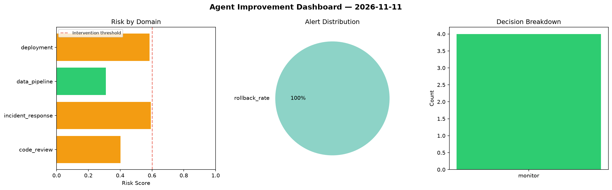
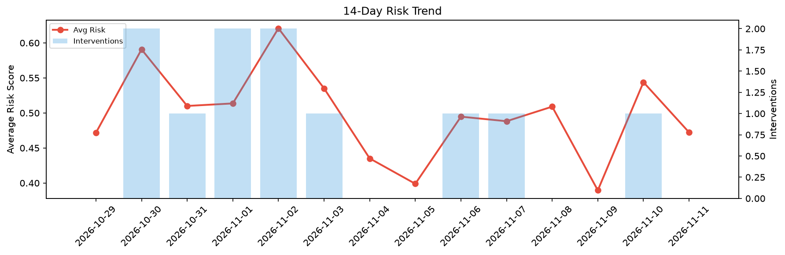

# Agent Improvement Report — 2026-11-11

**Cycle ID:** `b7442cb9` | **Avg Risk:** 0.4723 | **Interventions:** 0/4

## Risk Matrix

| Domain | Risk Score | Decision | Alerts |
|--------|-----------|----------|--------|
| code_review | 0.4019 | monitor | none |
| incident_response | 0.5919 | monitor | none |
| data_pipeline | 0.31 | monitor | none |
| deployment | 0.5854 | monitor | rollback_rate |

## Delta vs Yesterday

| Domain | Today | Yesterday | Change |
|--------|-------|-----------|--------|
| code_review | 0.4019 | 0.522 | 📉 -23.0% |
| incident_response | 0.5919 | 0.5341 | 📈 10.8% |
| data_pipeline | 0.31 | 0.6035 | 📉 -48.6% |
| deployment | 0.5854 | 0.516 | 📈 13.4% |

**Refinement:** `{'adjustment': 'tighten_thresholds', 'trend': 'degrading', 'window': 4}`