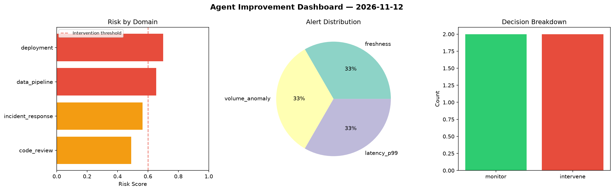
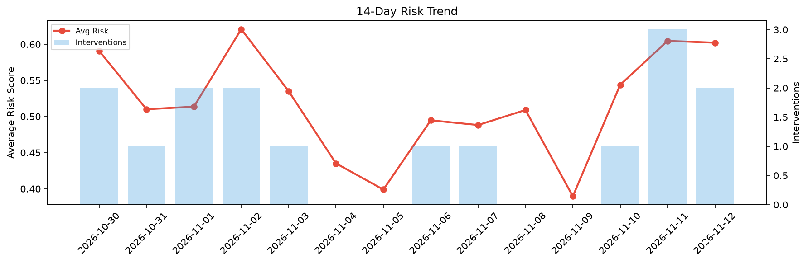

# Agent Improvement Report — 2026-11-12

**Cycle ID:** `bcf7c530` | **Avg Risk:** 0.6021 | **Interventions:** 2/4

## Risk Matrix

| Domain | Risk Score | Decision | Alerts |
|--------|-----------|----------|--------|
| code_review | 0.4894 | monitor | none |
| incident_response | 0.5644 | monitor | none |
| data_pipeline | 0.6545 | intervene | freshness, volume_anomaly |
| deployment | 0.7001 | intervene | latency_p99 |

## Delta vs Yesterday

| Domain | Today | Yesterday | Change |
|--------|-------|-----------|--------|
| code_review | 0.4894 | 0.3105 | 📈 57.6% |
| incident_response | 0.5644 | 0.8115 | 📉 -30.4% |
| data_pipeline | 0.6545 | 0.6925 | 📉 -5.5% |
| deployment | 0.7001 | 0.604 | 📈 15.9% |

**Refinement:** `{'adjustment': 'tighten_thresholds', 'trend': 'degrading', 'window': 4}`