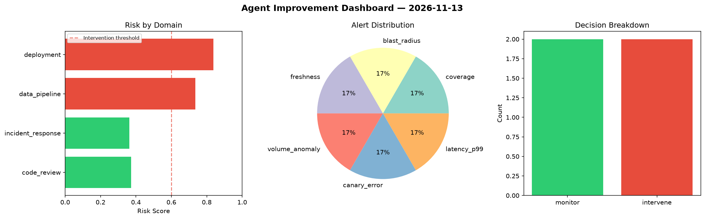
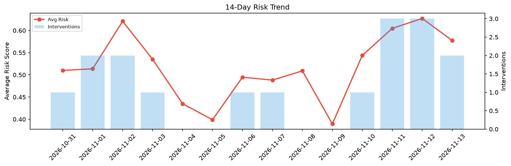

# Agent Improvement Report — 2026-11-13

**Cycle ID:** `b1b780f1` | **Avg Risk:** 0.5774 | **Interventions:** 2/4

## Risk Matrix

| Domain | Risk Score | Decision | Alerts |
|--------|-----------|----------|--------|
| code_review | 0.3721 | monitor | coverage |
| incident_response | 0.3632 | monitor | blast_radius |
| data_pipeline | 0.7363 | intervene | freshness, volume_anomaly |
| deployment | 0.838 | intervene | canary_error, latency_p99 |

## Delta vs Yesterday

| Domain | Today | Yesterday | Change |
|--------|-------|-----------|--------|
| code_review | 0.3721 | 0.6493 | 📉 -42.7% |
| incident_response | 0.3632 | 0.5192 | 📉 -30.0% |
| data_pipeline | 0.7363 | 0.6514 | 📈 13.0% |
| deployment | 0.838 | 0.6886 | 📈 21.7% |

**Refinement:** `{'adjustment': 'tighten_thresholds', 'trend': 'degrading', 'window': 4}`