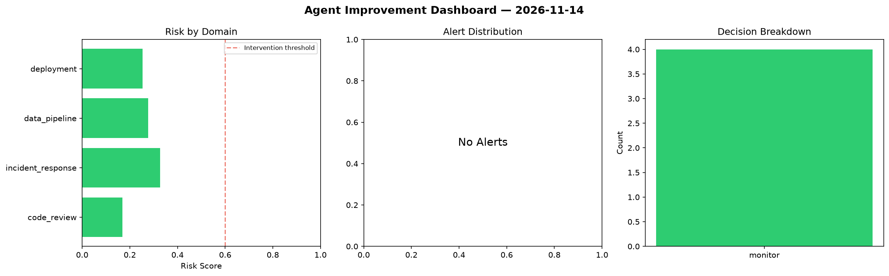
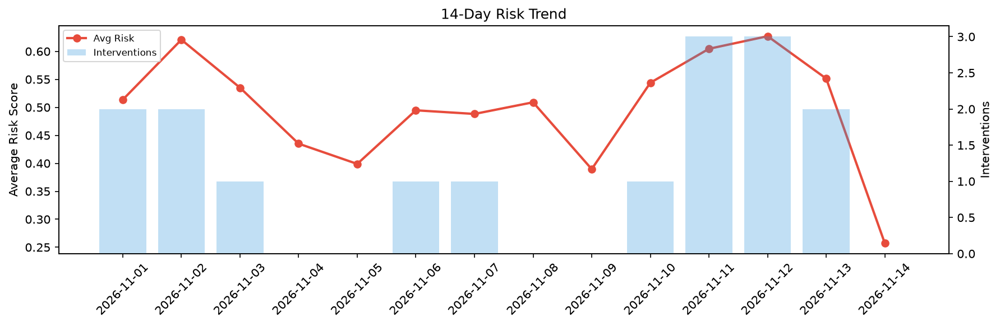

# Agent Improvement Report — 2026-11-14

**Cycle ID:** `b2b55583` | **Avg Risk:** 0.2571 | **Interventions:** 0/4

## Risk Matrix

| Domain | Risk Score | Decision | Alerts |
|--------|-----------|----------|--------|
| code_review | 0.1693 | monitor | none |
| incident_response | 0.3275 | monitor | none |
| data_pipeline | 0.2777 | monitor | none |
| deployment | 0.2537 | monitor | none |

## Delta vs Yesterday

| Domain | Today | Yesterday | Change |
|--------|-------|-----------|--------|
| code_review | 0.1693 | 0.4015 | 📉 -57.8% |
| incident_response | 0.3275 | 0.6137 | 📉 -46.6% |
| data_pipeline | 0.2777 | 0.6932 | 📉 -59.9% |
| deployment | 0.2537 | 0.4972 | 📉 -49.0% |

**Refinement:** `{'adjustment': 'tighten_thresholds', 'trend': 'degrading', 'window': 4}`