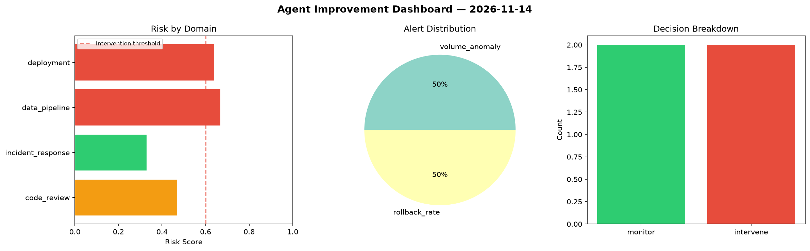
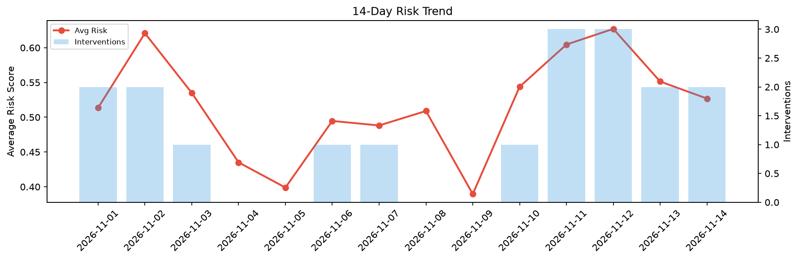

# Agent Improvement Report — 2026-11-14

**Cycle ID:** `9730d935` | **Avg Risk:** 0.5269 | **Interventions:** 2/4

## Risk Matrix

| Domain | Risk Score | Decision | Alerts |
|--------|-----------|----------|--------|
| code_review | 0.4704 | monitor | none |
| incident_response | 0.3289 | monitor | none |
| data_pipeline | 0.6683 | intervene | volume_anomaly |
| deployment | 0.6398 | intervene | rollback_rate |

## Delta vs Yesterday

| Domain | Today | Yesterday | Change |
|--------|-------|-----------|--------|
| code_review | 0.4704 | 0.4015 | 📈 17.2% |
| incident_response | 0.3289 | 0.6137 | 📉 -46.4% |
| data_pipeline | 0.6683 | 0.6932 | 📉 -3.6% |
| deployment | 0.6398 | 0.4972 | 📈 28.7% |

**Refinement:** `{'adjustment': 'tighten_thresholds', 'trend': 'degrading', 'window': 4}`