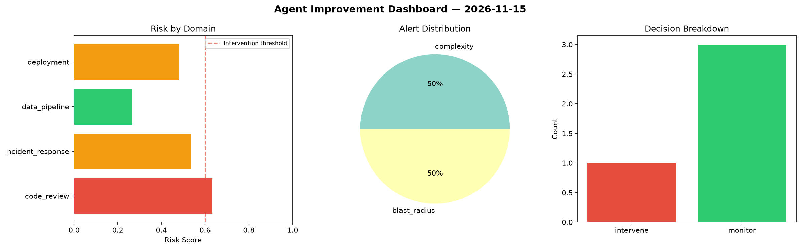

# Agent Improvement Report — 2026-11-15

**Cycle ID:** `48640a82` | **Avg Risk:** 0.4789 | **Interventions:** 1/4

## Risk Matrix

| Domain | Risk Score | Decision | Alerts |
|--------|-----------|----------|--------|
| code_review | 0.6321 | intervene | complexity |
| incident_response | 0.5354 | monitor | blast_radius |
| data_pipeline | 0.2679 | monitor | none |
| deployment | 0.4802 | monitor | none |

## Delta vs Yesterday

| Domain | Today | Yesterday | Change |
|--------|-------|-----------|--------|
| code_review | 0.6321 | 0.4704 | 📈 34.4% |
| incident_response | 0.5354 | 0.3289 | 📈 62.8% |
| data_pipeline | 0.2679 | 0.6683 | 📉 -59.9% |
| deployment | 0.4802 | 0.6398 | 📉 -24.9% |

**Refinement:** `{'adjustment': 'maintain', 'trend': 'improving', 'window': 4}`