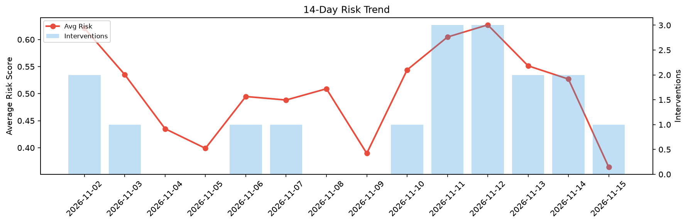

# Agent Improvement Report — 2026-11-15

**Cycle ID:** `1e277704` | **Avg Risk:** 0.3641 | **Interventions:** 1/4

## Risk Matrix

| Domain | Risk Score | Decision | Alerts |
|--------|-----------|----------|--------|
| code_review | 0.6196 | intervene | duplication, coverage |
| incident_response | 0.3888 | monitor | none |
| data_pipeline | 0.1111 | monitor | none |
| deployment | 0.3371 | monitor | canary_error |

## Delta vs Yesterday

| Domain | Today | Yesterday | Change |
|--------|-------|-----------|--------|
| code_review | 0.6196 | 0.4704 | 📈 31.7% |
| incident_response | 0.3888 | 0.3289 | 📈 18.2% |
| data_pipeline | 0.1111 | 0.6683 | 📉 -83.4% |
| deployment | 0.3371 | 0.6398 | 📉 -47.3% |

**Refinement:** `{'adjustment': 'maintain', 'trend': 'improving', 'window': 4}`