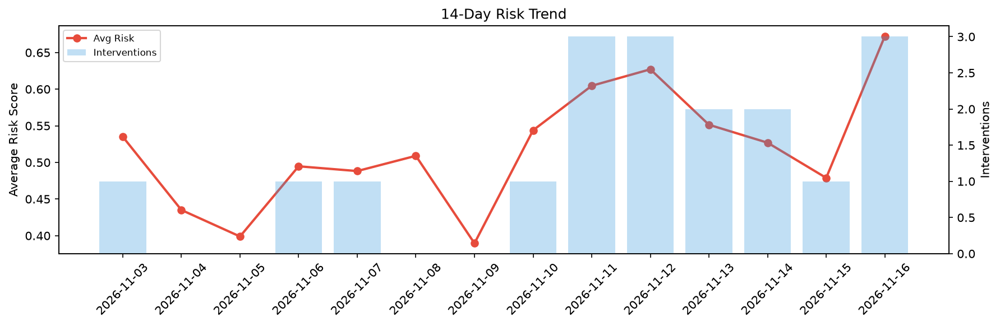

# Agent Improvement Report — 2026-11-16

**Cycle ID:** `90af8192` | **Avg Risk:** 0.6723 | **Interventions:** 3/4

## Risk Matrix

| Domain | Risk Score | Decision | Alerts |
|--------|-----------|----------|--------|
| code_review | 0.7951 | intervene | complexity, coverage |
| incident_response | 0.612 | intervene | blast_radius |
| data_pipeline | 0.5422 | monitor | schema_drift |
| deployment | 0.7399 | intervene | canary_error, latency_p99 |

## Delta vs Yesterday

| Domain | Today | Yesterday | Change |
|--------|-------|-----------|--------|
| code_review | 0.7951 | 0.6321 | 📈 25.8% |
| incident_response | 0.612 | 0.5354 | 📈 14.3% |
| data_pipeline | 0.5422 | 0.2679 | 📈 102.4% |
| deployment | 0.7399 | 0.4802 | 📈 54.1% |

**Refinement:** `{'adjustment': 'maintain', 'trend': 'improving', 'window': 4}`