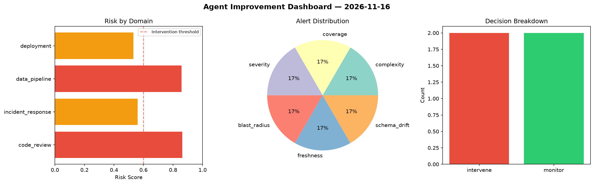

# Agent Improvement Report — 2026-11-16

**Cycle ID:** `ba7fd88d` | **Avg Risk:** 0.7029 | **Interventions:** 2/4

## Risk Matrix

| Domain | Risk Score | Decision | Alerts |
|--------|-----------|----------|--------|
| code_review | 0.8628 | intervene | complexity, coverage |
| incident_response | 0.5608 | monitor | severity, blast_radius |
| data_pipeline | 0.857 | intervene | freshness, schema_drift |
| deployment | 0.5309 | monitor | none |

## Delta vs Yesterday

| Domain | Today | Yesterday | Change |
|--------|-------|-----------|--------|
| code_review | 0.8628 | 0.6321 | 📈 36.5% |
| incident_response | 0.5608 | 0.5354 | 📈 4.7% |
| data_pipeline | 0.857 | 0.2679 | 📈 219.9% |
| deployment | 0.5309 | 0.4802 | 📈 10.6% |

**Refinement:** `{'adjustment': 'maintain', 'trend': 'improving', 'window': 4}`