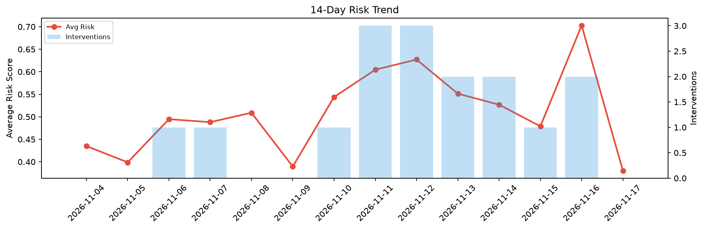

# Agent Improvement Report — 2026-11-17

**Cycle ID:** `06b5c443` | **Avg Risk:** 0.3799 | **Interventions:** 0/4

## Risk Matrix

| Domain | Risk Score | Decision | Alerts |
|--------|-----------|----------|--------|
| code_review | 0.362 | monitor | complexity |
| incident_response | 0.1487 | monitor | none |
| data_pipeline | 0.5421 | monitor | volume_anomaly |
| deployment | 0.4668 | monitor | rollback_rate |

## Delta vs Yesterday

| Domain | Today | Yesterday | Change |
|--------|-------|-----------|--------|
| code_review | 0.362 | 0.8628 | 📉 -58.0% |
| incident_response | 0.1487 | 0.5608 | 📉 -73.5% |
| data_pipeline | 0.5421 | 0.857 | 📉 -36.7% |
| deployment | 0.4668 | 0.5309 | 📉 -12.1% |

**Refinement:** `{'adjustment': 'tighten_thresholds', 'trend': 'degrading', 'window': 4}`