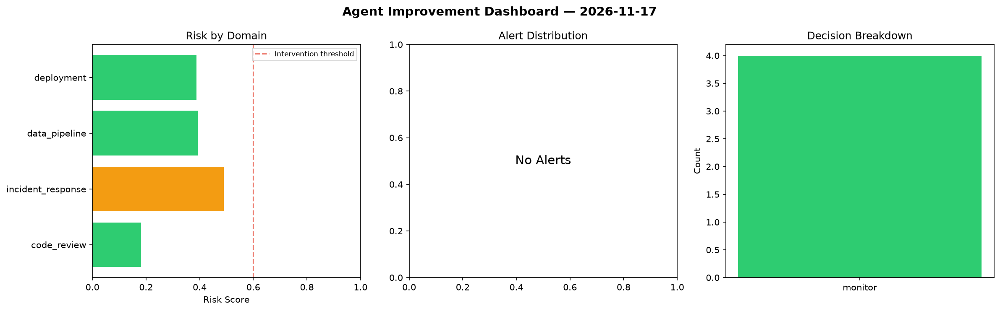

# Agent Improvement Report — 2026-11-17

**Cycle ID:** `e80bb5f3` | **Avg Risk:** 0.3631 | **Interventions:** 0/4

## Risk Matrix

| Domain | Risk Score | Decision | Alerts |
|--------|-----------|----------|--------|
| code_review | 0.1818 | monitor | none |
| incident_response | 0.4893 | monitor | none |
| data_pipeline | 0.3931 | monitor | none |
| deployment | 0.3881 | monitor | none |

## Delta vs Yesterday

| Domain | Today | Yesterday | Change |
|--------|-------|-----------|--------|
| code_review | 0.1818 | 0.8628 | 📉 -78.9% |
| incident_response | 0.4893 | 0.5608 | 📉 -12.7% |
| data_pipeline | 0.3931 | 0.857 | 📉 -54.1% |
| deployment | 0.3881 | 0.5309 | 📉 -26.9% |

**Refinement:** `{'adjustment': 'tighten_thresholds', 'trend': 'degrading', 'window': 4}`