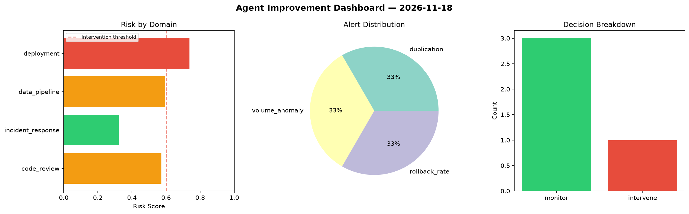

# Agent Improvement Report — 2026-11-18

**Cycle ID:** `27db9307` | **Avg Risk:** 0.5571 | **Interventions:** 1/4

## Risk Matrix

| Domain | Risk Score | Decision | Alerts |
|--------|-----------|----------|--------|
| code_review | 0.5726 | monitor | duplication |
| incident_response | 0.3234 | monitor | none |
| data_pipeline | 0.5956 | monitor | volume_anomaly |
| deployment | 0.7369 | intervene | rollback_rate |

## Delta vs Yesterday

| Domain | Today | Yesterday | Change |
|--------|-------|-----------|--------|
| code_review | 0.5726 | 0.7735 | 📉 -26.0% |
| incident_response | 0.3234 | 0.5219 | 📉 -38.0% |
| data_pipeline | 0.5956 | 0.3648 | 📈 63.3% |
| deployment | 0.7369 | 0.6549 | 📈 12.5% |

**Refinement:** `{'adjustment': 'tighten_thresholds', 'trend': 'degrading', 'window': 4}`