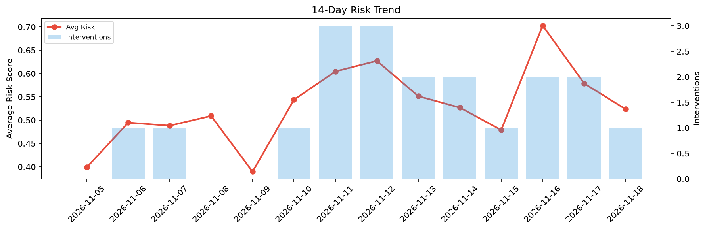

# Agent Improvement Report — 2026-11-18

**Cycle ID:** `d130a6b7` | **Avg Risk:** 0.5235 | **Interventions:** 1/4

## Risk Matrix

| Domain | Risk Score | Decision | Alerts |
|--------|-----------|----------|--------|
| code_review | 0.6794 | intervene | complexity |
| incident_response | 0.3681 | monitor | blast_radius |
| data_pipeline | 0.559 | monitor | schema_drift |
| deployment | 0.4876 | monitor | canary_error |

## Delta vs Yesterday

| Domain | Today | Yesterday | Change |
|--------|-------|-----------|--------|
| code_review | 0.6794 | 0.7735 | 📉 -12.2% |
| incident_response | 0.3681 | 0.5219 | 📉 -29.5% |
| data_pipeline | 0.559 | 0.3648 | 📈 53.2% |
| deployment | 0.4876 | 0.6549 | 📉 -25.5% |

**Refinement:** `{'adjustment': 'maintain', 'trend': 'improving', 'window': 4}`