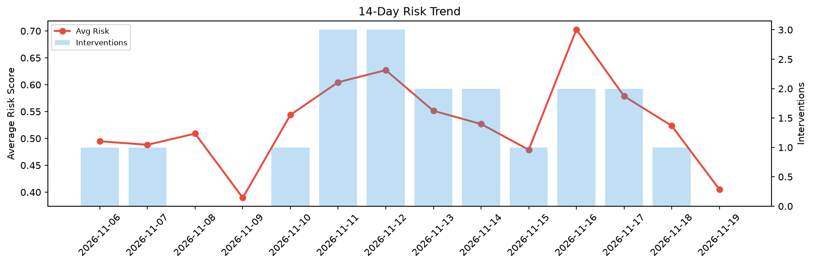

# Agent Improvement Report — 2026-11-19

**Cycle ID:** `73b04ec5` | **Avg Risk:** 0.4053 | **Interventions:** 0/4

## Risk Matrix

| Domain | Risk Score | Decision | Alerts |
|--------|-----------|----------|--------|
| code_review | 0.5938 | monitor | duplication, coverage |
| incident_response | 0.2413 | monitor | none |
| data_pipeline | 0.334 | monitor | none |
| deployment | 0.4522 | monitor | canary_error |

## Delta vs Yesterday

| Domain | Today | Yesterday | Change |
|--------|-------|-----------|--------|
| code_review | 0.5938 | 0.6794 | 📉 -12.6% |
| incident_response | 0.2413 | 0.3681 | 📉 -34.4% |
| data_pipeline | 0.334 | 0.559 | 📉 -40.3% |
| deployment | 0.4522 | 0.4876 | 📉 -7.3% |

**Refinement:** `{'adjustment': 'maintain', 'trend': 'improving', 'window': 4}`