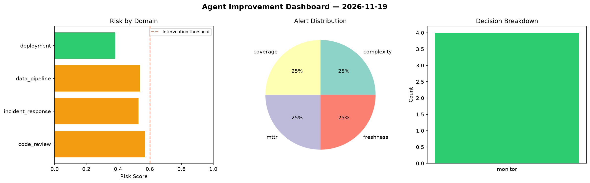

# Agent Improvement Report — 2026-11-19

**Cycle ID:** `527e2544` | **Avg Risk:** 0.5053 | **Interventions:** 0/4

## Risk Matrix

| Domain | Risk Score | Decision | Alerts |
|--------|-----------|----------|--------|
| code_review | 0.5701 | monitor | complexity, coverage |
| incident_response | 0.529 | monitor | mttr |
| data_pipeline | 0.5393 | monitor | freshness |
| deployment | 0.3829 | monitor | none |

## Delta vs Yesterday

| Domain | Today | Yesterday | Change |
|--------|-------|-----------|--------|
| code_review | 0.5701 | 0.6794 | 📉 -16.1% |
| incident_response | 0.529 | 0.3681 | 📈 43.7% |
| data_pipeline | 0.5393 | 0.559 | 📉 -3.5% |
| deployment | 0.3829 | 0.4876 | 📉 -21.5% |

**Refinement:** `{'adjustment': 'maintain', 'trend': 'improving', 'window': 4}`