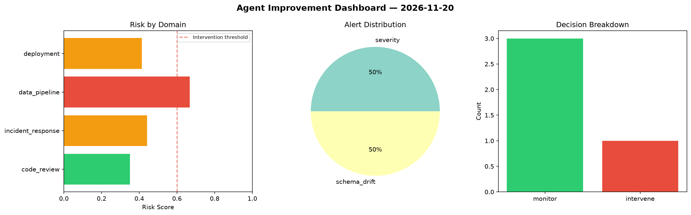
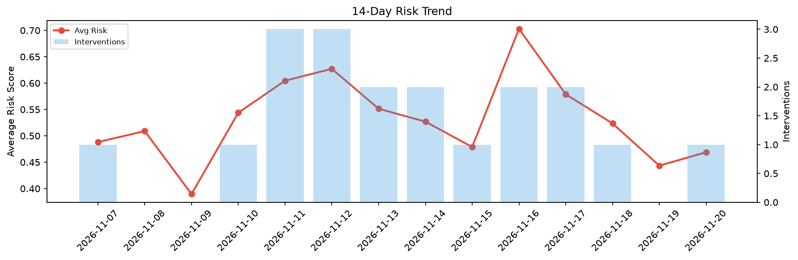

# Agent Improvement Report — 2026-11-20

**Cycle ID:** `aa272f36` | **Avg Risk:** 0.4688 | **Interventions:** 1/4

## Risk Matrix

| Domain | Risk Score | Decision | Alerts |
|--------|-----------|----------|--------|
| code_review | 0.3515 | monitor | none |
| incident_response | 0.4422 | monitor | severity |
| data_pipeline | 0.6673 | intervene | schema_drift |
| deployment | 0.4142 | monitor | none |

## Delta vs Yesterday

| Domain | Today | Yesterday | Change |
|--------|-------|-----------|--------|
| code_review | 0.3515 | 0.3935 | 📉 -10.7% |
| incident_response | 0.4422 | 0.3146 | 📈 40.6% |
| data_pipeline | 0.6673 | 0.5164 | 📈 29.2% |
| deployment | 0.4142 | 0.5495 | 📉 -24.6% |

**Refinement:** `{'adjustment': 'tighten_thresholds', 'trend': 'degrading', 'window': 4}`