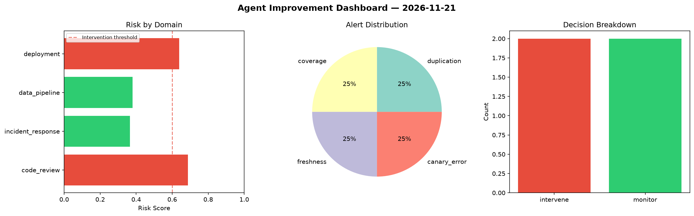

# Agent Improvement Report — 2026-11-21

**Cycle ID:** `e209b207` | **Avg Risk:** 0.5179 | **Interventions:** 2/4

## Risk Matrix

| Domain | Risk Score | Decision | Alerts |
|--------|-----------|----------|--------|
| code_review | 0.6882 | intervene | duplication, coverage |
| incident_response | 0.3652 | monitor | none |
| data_pipeline | 0.3796 | monitor | freshness |
| deployment | 0.6384 | intervene | canary_error |

## Delta vs Yesterday

| Domain | Today | Yesterday | Change |
|--------|-------|-----------|--------|
| code_review | 0.6882 | 0.6305 | 📈 9.2% |
| incident_response | 0.3652 | 0.5276 | 📉 -30.8% |
| data_pipeline | 0.3796 | 0.5507 | 📉 -31.1% |
| deployment | 0.6384 | 0.3542 | 📈 80.2% |

**Refinement:** `{'adjustment': 'maintain', 'trend': 'improving', 'window': 4}`