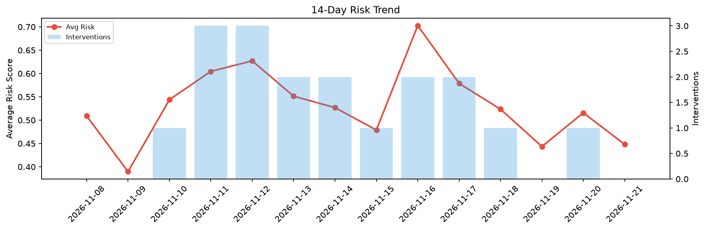

# Agent Improvement Report — 2026-11-21

**Cycle ID:** `37885b2b` | **Avg Risk:** 0.4481 | **Interventions:** 0/4

## Risk Matrix

| Domain | Risk Score | Decision | Alerts |
|--------|-----------|----------|--------|
| code_review | 0.5432 | monitor | complexity |
| incident_response | 0.4302 | monitor | none |
| data_pipeline | 0.4605 | monitor | none |
| deployment | 0.3586 | monitor | none |

## Delta vs Yesterday

| Domain | Today | Yesterday | Change |
|--------|-------|-----------|--------|
| code_review | 0.5432 | 0.6305 | 📉 -13.8% |
| incident_response | 0.4302 | 0.5276 | 📉 -18.5% |
| data_pipeline | 0.4605 | 0.5507 | 📉 -16.4% |
| deployment | 0.3586 | 0.3542 | 📈 1.2% |

**Refinement:** `{'adjustment': 'maintain', 'trend': 'improving', 'window': 4}`